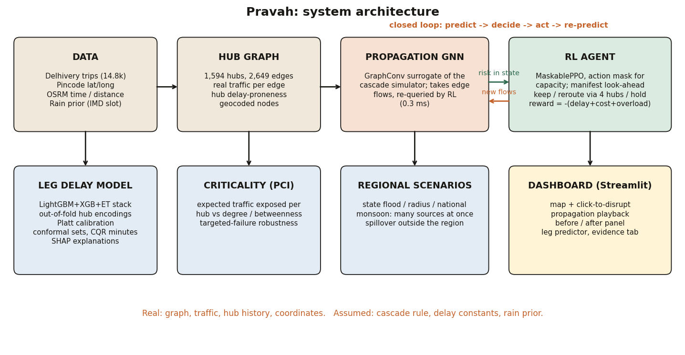

# Pravah: predicting how a hub disruption spreads, and re-routing around it

Pravah takes the Delhivery logistics network (1,594 hubs, 2,649 hub-to-hub edges, 26k legs), predicts which
legs and hubs are at risk, simulates how a disruption propagates, and learns a rerouting policy. A Streamlit
dashboard puts it together.



## Quick start

```bash
pip install -r requirements.txt
streamlit run app/dashboard.py                      # dashboard (all trained artifacts are included)
python pipeline.py --hub "Bhiwandi" --severity 0.8  # same loop on the command line
python -m pytest -q tests                           # 37 tests incl. leakage, conformal-coverage and API checks
uvicorn api.main:app --reload                       # REST API, docs at http://127.0.0.1:8000/docs
python -m evaluation.sweep                          # multi-scenario evaluation table (held-out hubs)
python run_all.py --fast                            # re-train everything quickly (python run_all.py --list)
```

Raw data (`data/raw/delhivery_data.csv`) and the processed tables are included, so the dashboard runs
without re-downloading anything. `data/prepare_geo.py` needs internet once if you rebuild the geocoding.

## What is in the box

| Part | Where | Headline result (test data, never used for fitting or selection) |
|---|---|---|
| Baseline leg-delay model (XGBoost) | `ml/` | PR-AUC 0.670 (base rate 0.233) |
| **Advanced leg-delay model** | `advanced/` | **PR-AUC 0.759**, paired gain +0.090, 95% CI [0.067, 0.113] |
| Out-of-time check (train early, test late) | `advanced/` | PR-AUC 0.622 -> 0.741 |
| **Calibrated uncertainty (conformal)** | `advanced/` | 90.4% / 90.9% coverage of delayed / on-time legs (target 90%) |
| **Delay minutes with 90% interval (CQR)** | `advanced/` | coverage 91.1%, MAE 30.4 min vs 43.3 naive |
| Evidence check for propagation | `analysis/` | no cross-hub cascade is visible in the data |
| Hub-risk models: GraphSAGE, GAT, hybrid | `gnn/hub_risk*.py` | GNNs do not beat XGBoost; hybrid +0.014 AUC (within noise) |
| Cascade simulator + propagation GNN | `graph/cascade.py`, `gnn/propagation.py` | GNN matches the simulator (MAE 0.022, precision@5 0.99) |
| **Regional / monsoon scenarios** | `novelty/scenarios.py` | many simultaneous sources, spillover outside the region |
| **Pravah Criticality Index** | `novelty/criticality.py` | traffic-weighted exposure per hub, targeted-failure robustness |
| **RL rerouting (masked PPO)** | `rl/` | masked PPO cuts excess delay 20.9 -> 13.7 h (-34%) on unseen hubs with 0 overloads; a hand-written risk-aware rule reaches 11.8 h, so RL does **not** beat the best rule |
| Dashboard | `app/` | 5 tabs, click-to-disrupt, propagation playback, before/after, CSV / JSON export |
| **REST API** | `api/` | `/simulate`, `/propagation`, `/hubs`, `/health`; see `docs/API.md` |
| **Evaluation sweep** | `evaluation/` | held-out hubs x severities x manifests, by state, latency p50 / p95 |

## What is novel here, and what is not

1. **Leakage-safe features.** Hub delay-rate encodings are computed out-of-fold; hub counts and graph
   centrality come from training legs only. `tests/` shuffles the labels and checks the encoding carries no signal.
2. **Uncertainty you can act on.** Platt-calibrated probabilities, class-conditional conformal sets (the model
   says "delayed", "on time" or "uncertain" with a 90% guarantee), and conformalized quantile regression for
   the extra minutes. SHAP explains each prediction.
3. **Honest validation.** Split by trip, out-of-time split, cold-start hubs, trip-level bootstrap CIs.
4. **Regional scenarios.** A flood hits a region, not a hub. The cascade runs from many sources on the full graph.
5. **Criticality index.** Expected share of network traffic exposed if a hub fails. It correlates 0.93 with plain
   traffic volume, so it is mostly a traffic-weighted ranking; it differs from degree/betweenness (0.55 / 0.44)
   and surfaces a few "hidden" hubs. We do not claim more than that.
6. **RL with a hard constraint and proper selection.** Capacity violations are masked, hubs are split
   train/val/test, three seeds, a no-masking ablation and a strong rule-based baseline.

## What the data does and does not support

`analysis/reports/propagation_evidence.txt` (reproducible): an upstream hub's delays predict a downstream hub's
delays no better than a random hub does (-0.02 vs -0.01); trip-chain "contagion" disappears once each hub's own
delay rate is removed; there is no load-delay relationship. Delay-proneness is a stable (r = 0.86), regional
hub property. So **cross-hub delay propagation is not observable in this dataset.**

- The cascade rule in `graph/cascade.py` is **assumed**. The propagation GNN is a fast surrogate of that
  simulator; its accuracy is measured against simulated labels, not observed spread.
- Every delay constant in `rl/env.py` is **assumed**. RL results compare policies inside a simulation; they are
  not measured savings on real shipments. Pipeline batches are synthetic.
- Rainfall intensity is a **coarse prior** unless you supply IMD data (`data/raw/imd_state_rainfall.csv`,
  columns `state,rainfall_mm`). The IMD API was not reachable when this was built.
- Between-hub road distance uses haversine x 1.3 where no logged leg exists (no routing API available).
- The leg model's distance feature is the leg's recorded distance; if it is not known at dispatch, replace it
  with the routing-engine distance.
- Only one courier's data and about 3.5 weeks (Sep-Oct 2018): no seasonality, no multi-courier validation.

## Results in more detail

**Leg-delay model** (`advanced/reports/advanced_report.txt`, test n = 3,981 legs)

| Model | PR-AUC | ROC-AUC | Brier | F1 |
|---|---|---|---|---|
| Baseline XGBoost, one-hot top-40 hubs (retrained on train only) | 0.670 | 0.839 | 0.122 | 0.607 |
| LightGBM (Optuna, 30 trials) + Platt, final | 0.759 | 0.889 | 0.103 | 0.687 |
| Stacked LGBM+XGB+ExtraTrees (not chosen: gain < 0.002 on validation) | 0.762 | 0.890 | 0.102 | 0.689 |

The strongest feature by SHAP is the smoothed delay history of the exact hub pair, then hour of day and
planned drive time. The original baseline reports 0.667 after refitting on train + validation; the table
re-trains it on train only so the comparison is like for like.

**Hub risk** (`gnn/reports/`, 228 labelled hubs, CV over hubs): state mean 0.668, XGBoost 0.706, GraphSAGE 0.660,
GAT 0.671, XGBoost + neighbourhood labels 0.719 (sd 0.006 to 0.022 across repeats).

**RL** (`rl/reports/rl_report.txt`):

Test = 300 episodes on 23 disrupted hubs never used for training or seed selection (200k steps, 3 seeds).

| Policy | Excess delay (h) | Overloads/ep | Contained |
|---|---|---|---|
| Keep planned route | 20.9 | 0.00 | 0% |
| Nearest hub (greedy rule) | 23.1 | 0.00 | 21% |
| **Masked PPO (selected by validation)** | **13.7** | **0.00** | 18% |
| Masked PPO, mean of 3 seeds | 14.0 +/- 0.4 | 0.00 | 18% |
| PPO without masking (ablation) | 13.4 | 0.27 | 17% |
| Risk-aware rule (hand-written, uses the simulator's constants) | 11.8 | 0.00 | 39% |
| One-step lookahead (oracle, queries the simulator) | 11.3 | 0.00 | 48% |

Paired bootstrap of the selected agent's excess delay minus the other policy (hours, 95% CI): vs keep
-7.12 [-7.62, -6.61]; vs nearest hub -9.33 [-11.73, -7.38]; vs risk-aware rule +1.92 [+1.73, +2.12]; vs
oracle +2.45 [+2.26, +2.65]. "Contained" = excess cut by 50%+ and no overload.

## Layout

```
app/        dashboard.py (Streamlit), engine.py (closed loop, no UI code)
advanced/   leakage-safe features, tuned models, calibration, conformal, CQR, SHAP, predictor
novelty/    criticality.py, scenarios.py
ml/         baseline leg model        gnn/    hub-risk models, propagation GNN
graph/      graph build + cascade     rl/     env, policies, training
analysis/   propagation evidence      tests/  pytest suite
api/        FastAPI service           evaluation/  scenario sweep and report
docs/       REPORT.md, VIVA_QA.md, API.md, CASE_STUDY_COVERAGE.md
legacy/     superseded first-generation code
```

## Data

Delhivery Logistics Dataset (Kaggle `santanukundu/delhivery-dataset`): 144,867 checkpoint rows, 14,817 trips,
12 Sep to 6 Oct 2018. `actual_time`, `osrm_time` and distance are cumulative within a leg, so
`data/prepare_data.py` takes the max per (trip, source, destination): 26,368 legs. Target:
`is_delayed = actual_time > 2.6 x osrm_time` (about the 75th percentile of the ratio; one constant in
`ml/problem.py`). Short legs are flagged more often (41% of the shortest quartile vs 16% of the longest).

## Deployment

```bash
docker compose up --build        # dashboard on :8501, API on :8000
```

CI (`.github/workflows/ci.yml`) runs the test suite and the CLI smoke test on every push. What the case study asked
for and what was not built (OSRM, IMD, multi-courier data) is listed in `docs/CASE_STUDY_COVERAGE.md`.
